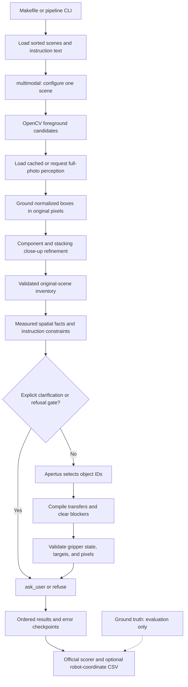

# Path B Architecture

## Purpose and scope

Path B converts a workcell RGB photograph and independent English instructions
into a grounded robot plan, a clarification question, or a refusal. OpenCV supplies
measured foreground evidence; Apertus supplies object identities and language
reasoning. The implementation lives in `pipelines/path_b_wahyu/`.

The implementation does not execute a robot. Its output is the submission contract
in `../../schema/result.schema.json`. Evaluation and conversion to robot coordinates
remain in the existing `../../starter/` tools. Inference never reads ground-truth
masks, reference plans, CSV expected answers, or instruction category labels.

## End-to-end flow



Every instruction starts from the original inventory. The state simulation inside
one instruction never changes the scene used by the next instruction.

## Module responsibilities

| File | Responsibility | Useful entry points |
|---|---|---|
| `Makefile` | Environment setup, ten-scene run, scoring, offline tests | `test`, `setup`, `run`, `evaluate`, `unit`, `help` |
| `pipeline.py` | Dataset orchestration, scene workers, ordered checkpoints, submission formatting | `pipeline`, `finalizing_output_format` |
| `scene.py` | Scene discovery, category-prefix removal, JSON output | `load_scenes`, `extract_instructions`, `save_json` |
| `multimodal.py` | Thin single-scene orchestrator, client configuration, final trace persistence | `llm_processing` |
| `apertus_client.py` | JPEG transport, JSON extraction/repair, bounded correction requests | `encode_image`, `parse_model_json`, `make_json_request` |
| `measure.py` | Foreground contours, shape/color descriptors, interior points, optional interactive preview | `detect_objects` |
| `grounding.py` | Box normalization, proposal matching, local segmentation, support reconciliation, spatial facts | `ground_inventory`, `ground_object`, `planning_inventory` |
| `perception.py` | Full-photo cache, debug assets, missing-component crops, overlapping-object crops | `load_inventory`, `refine_components`, `refine_stacks` |
| `instruction_planning.py` | Per-instruction gates, selection constraints, model planning, isolated fallbacks | `plan_instructions`, `validate_instruction_response` |
| `planner.py` | Shared-destination transfer serialization and blocker graph compilation | `compile_transfer_groups`, `expand_blockers` |
| `safety.py` | Explicit motion restrictions and deterministic selection constraints | `explicit_refusal`, `stationary_blocker_refusal`, named/ordinal/relative helpers |
| `validation.py` | Inventory, pixel, and action-state validation | `validate_inventory`, `validate_pixel`, `validate_plan` |
| `template_prompt.py` | Full-photo, component, stacking, and planning prompts | `PERCEPTION_PROMPT`, `COMPONENT_PROMPT`, `STACK_PROMPT`, `PLANNING_PROMPT` |
| `test_pipeline.py` | Offline regression and orchestration tests | `PipelineTests`, `IntegrationTests` |
| `benchmark.json` | Historical measured comparison and preserved result digest | Metadata only; never an inference input |
| `README.md` | User-facing setup and test commands | Start here to run the project |
| `DOCUMENTATION_LOG.md` | Session handoff and targeted troubleshooting map | Start here in a new coding session |

`multimodal.py` re-exports its earlier image/parser/validator helpers so existing
notebooks and callers keep working. New code should import helpers from their
owning modules. The original lowercase `template_prompt` import remains available;
`PLANNING_PROMPT` is the uppercase alias for the same unchanged string.

## Data contracts and coordinate conventions

### Scene input

Each `scene_*` directory contains `rgb.png` and `instructions.txt`. The loader
sorts directories and keeps instruction order. It accepts tab-separated category
prefixes, known category prefixes separated by whitespace, and unlabelled text.
Prefixes and comment/header lines are not sent to the model. Missing instruction
files are reported and skipped; unreadable RGB files fail during scene processing.

### Foreground proposals

`detect_objects` returns a list of candidates and an original-size binary mask.
A candidate contains `id`, `pixel`, `bbox`, `area_px`, `color`, `solidity`,
`circularity`, `aspect_ratio`, `polygon_vertices`, and `category_hint`. The hint is
a heuristic, not a confirmed category. Candidate IDs follow image reading order.

The default detector uses separate red, yellow, other-color, and neutral masks.
With an empty-workcell reference it instead uses LAB background subtraction.
Opening removes noise; closing joins small fragments inside each separate mask.
Area, shape, and image-edge filters remove implausible proposals. The point is a
distance-transform maximum on foreground, not a contour centroid that may fall
inside a gear hole.

### Perception and grounded inventory

Apertus initially returns coarse boxes normalized to `0..1000`. Only
`normalized_bbox_to_pixels` converts those boxes to original image coordinates.
Images sent to the endpoint are JPEGs capped at a 1280-pixel longest side; transport
resizing does not change the final coordinate frame.

A grounded object has an instance `id`, category `name`, pixel `bbox`, integer
`pixel`, `tray`, and boolean `held_by_human`. Its `grounding` field records the
measurement source. Optional diagnostic fields preserve corrected tray labels or
occlusion evidence. `relations` contains physical `on_top_of` edges with upper
object as `subject` and support object as `object`.

`bbox` is `[x1, y1, x2, y2]`, with exclusive right/bottom bounds. `pixel` is
`[u, v]`, where `u` increases rightward and `v` downward from the top-left corner.
Object IDs are unique lowercase snake_case; categories are not instance IDs.

Grounding matches a color-compatible measured proposal near a coarse box. It
rejects overly large merged proposals and tolerates modest localization error.
When no compatible proposal exists, local category-aware segmentation chooses a
solid point with a center preference. Tray and hand points are box references.

### Spatial facts and internal plans

`planning_inventory` supplies eligible pick IDs, destinations, box centers,
blockers, distance rankings, and left/right orderings. Distances use box centers;
action pixels use the measured interior points. Named, ordinal, and immediate
neighbor constraints are supplied to Apertus and checked again after planning.

The model emits local numeric instruction IDs and actions that select inventory
IDs. It does not choose final action coordinates. The compiler converts grouped
picks with a shared destination into alternating pick/place pairs, including a
single destination broadcast to several picks. It clears incidental blockers for
the transfer before touching their supports. Blockers explicitly selected by the
model remain in the original action sequence. A copied support graph detects
cycles and models removal/replacement of blockers.

### Submission output

A submission has `team` and `results`. Each entry has a scene-qualified
`instruction_id`, `target_pixel`, and `actions`. The target is the first actual
pick, which may be a cleared blocker rather than the noun in the instruction.
Clarification/refusal entries have a null target and exactly one corresponding
action. Pixel bounds, human contact, allowed destinations, container restrictions,
and single-gripper occupancy are validated before output.

## Client, cache, concurrency, and errors

The default model is `apertus-v1.5-70b`; the default endpoint is
`https://hackapertus.livemap.sh/v1`. The root `.env` supplies `API_KEY` and optional
`APERTUS_MODEL` / `APERTUS_BASE_URL`. `--model` overrides the model environment
variable. An injected SDK-compatible client supports offline tests.

Task prompts are appended to the user content, matching the tested request shape.
Requests use temperature zero, a 6000-token output cap, a 180-second client timeout,
and up to two SDK retries. Semantic validation allows three attempts total; an
identical invalid reply ends correction early. A complete JSON value is extracted
before considering trailing explanation; `json-repair` is the fallback parser.

The full-photo cache stores raw model perception only. Its key is SHA256 of image
bytes, perception prompt bytes, model name, and endpoint string. Cached raw data
is grounded again on every run. Component refinement, stack refinement, and
instruction planning are never reused from that cache. Corrupt or invalid cached
perception currently fails the scene rather than being silently refreshed.

Each scene runs in a separate thread; its instructions and model requests run
sequentially. The main thread consumes `executor.map` in dataset order and writes
result/error checkpoints after each scene. A slow early scene can delay checkpoint
visibility even when later scenes have completed. Make defaults to three workers;
the direct CLI defaults to one. More workers can increase endpoint load.

| Failure boundary | Behavior |
|---|---|
| Full-photo perception/grounding or final inventory validation | Scene fallback for every instruction; scene error retained |
| Component/stack semantic validation | Record `refinement_errors`; retain the base inventory or prior relations |
| Transport failure during refinement | Propagate to the scene boundary |
| Planning/validation for one instruction | Explicit ask_user processing fallback; preserve other instructions |
| Genuine ambiguous reference or explicit unsafe demand | Normal clarification/refusal decision, not a processing error |

Results with processing failures are still written, but the pipeline exits with
an error. Optional semantic refinement failures alone do not cause that exit.
An ask_user fallback caused by processing failure should not be reported as a
successful semantic interpretation.

## Bottlenecks found and addressed

| Bottleneck or failure | Change made | Current status |
|---|---|---|
| Prompt asked for original pixels while code rescaled them as 0–1000 | Separate normalized-box conversion from trusted final pixel lookup | Coordinate-frame defect resolved |
| Pure prompting was asked to recognize, localize, and plan simultaneously | Short full-photo perception, measured grounding, and independent text planning | Complexity reduced; perception remains model-dependent |
| Large photos lost small-object detail or encouraged mistaken identities | Transport-size cap and targeted component/stack close-ups | Mitigated, not universal recognition |
| Touching red/yellow objects merged in one segmentation mask | Segment colors separately before morphology | Different-color merging reduced; same-color merging remains possible |
| Centroids landed in holes or on background | Interior distance-transform points plus local foreground fallback | Geometric grounding improved; not a certified grasp pose |
| A mug handle/part fragment became a duplicate object | Suppress proposals covered by known objects and nearby mug/human-held regions | Duplicate risk reduced |
| Grey/white parts and hardware were confused | Lower neutral brightness threshold, component crops, mechanical shape cues | Tuned for the fixed challenge workcell |
| Empty dark tray was omitted or support labels contradicted geometry | Visible-dark-region reference recovery and tray membership reconciliation | Fixed-workcell omission handling added |
| 2D left/below relations were treated as physical stack edges | Ignore directional edges for blocker logic; compute directions from centers | Relation-type confusion resolved |
| Stacking direction was reversed | Close-up stack pass and dominant-color occlusion reconciliation for measured distinct-color pairs | Mitigated; RGB cannot prove physical support |
| Closest, side, ordinal, and ambiguous targets were guessed | Measured ranks plus named/ordinal/relative constraints and unresolved-reference gates | Deterministic checks added for supported English patterns |
| Model picked several objects before placing any | Shared-destination serialization and gripper-state validation | Invalid grouped transfers compiled or rejected |
| Supporting object was moved before its blocker | Recursive blocker clearing and explicit protected-blocker refusal | Visible support graph respected; graph perception can still be wrong |
| One bad instruction discarded an entire scene's useful answers | Plan and validate instructions separately | Failure isolation resolved |
| Repeated invalid replies consumed extra calls | Bounded corrections and duplicate-reply early exit | Retry waste reduced |
| API latency dominated runs | Raw-perception cache and bounded scene concurrency | Mitigated; no latency benchmark or guaranteed speedup measured |
| One large module mixed SDK, perception, validation, and planning | Split orchestration into explicit modules, centralize prompts, remove dead preprocessing/debug work | Maintainability improved with replay parity verification |

## Evidence and remaining limits

The existing `results/path_b_wahyu.json` scored 24.5/65: 16/40 grounding hits and
4/10 correct safety decisions. The preserved `out/results_optimized.json` scored
65/65: 40/40 grounding hits, 10/10 correct safety decisions, 50 schema-valid unique
answers, and zero processing errors. Its digest and provenance are recorded in
`benchmark.json`. That optimization run reused cached raw full-photo perception;
all grounding, close-up refinement, and instruction planning were rerun.

A separate root `report.json` present when this cleanup started records 55.8/65
(grounding 0.90, correct non-plan decisions 0.90, false-alarm rate 0.10). It is a
separate local run, not the preserved benchmark. Fresh model perception and later
model decisions can vary despite temperature zero; 65/65 is not a fresh-run or
held-out guarantee.

During cleanup, all 22 existing tests passed before changes. The expanded offline
suite adds orchestration, cache reuse, bounded correction, and partial-checkpoint
coverage. Replaying the available ten scenes' recorded replies produced identical
outputs, errors, and all 49 SDK request payloads before and after refactoring.
Prompt bytes and detector behavior were preserved. No live endpoint was needed
for this equivalence check, and the preserved result file was not rewritten.

The scorer checks the first pick and decision type. It does not validate every
step, collision-free placement, grasp orientation, gripper clearance, or physical
robot safety. Held-out evaluation, a certified safety controller, full action-plan
review, and physical robot execution remain outside the completed work. Regex
constraints cover selected English forms, not arbitrary linguistic variants.
Missing human-contact flags still default to false unless other evidence marks
them; that is a perception limitation, not proof that human contact is absent.

## Running and targeted diagnosis

```sh
make -C pipelines/path_b_wahyu
make -C pipelines/path_b_wahyu unit
make -C pipelines/path_b_wahyu evaluate
```

Make creates/uses the root `.venv`, installs requirements, runs all ten scenes with
a new cache directory, then scores the output. The direct CLI remains available
for selected scenes, custom endpoints, and explicit cache reuse. See `README.md`.

| Symptom | Inspect first |
|---|---|
| Wrong identity, missing part, reversed stack | `perception.py`, `template_prompt.py`, scene `trace.json` |
| Pixel on a hole/background or oversized candidate | `measure.py`, `grounding.py`, `mask.png`, `candidates.jpg` |
| Wrong nearest/ordinal/relative target | `planning_inventory`, `safety.py`, `validate_instruction_response` |
| Bad pick/place ordering or blocked support | `planner.py`, `validation.py` |
| Missing result or nonzero exit | Adjacent `.errors.json`, then `pipeline.py` |
| Unexpectedly repeated perception | `load_inventory`, cache key inputs, Make's fresh-cache default |
| Changed score after a new run | Confirm result path/cache provenance before comparing metrics |

Use `DOCUMENTATION_LOG.md` to resume work without rereading unrelated pipelines.
