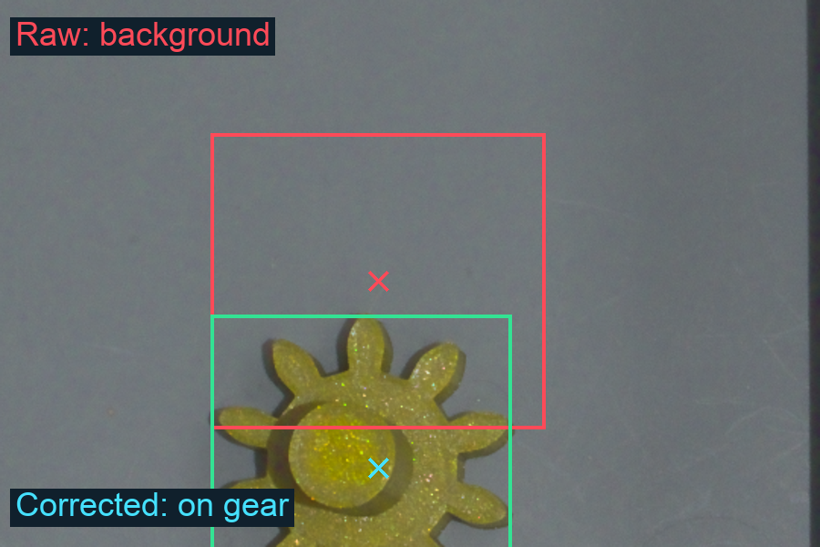
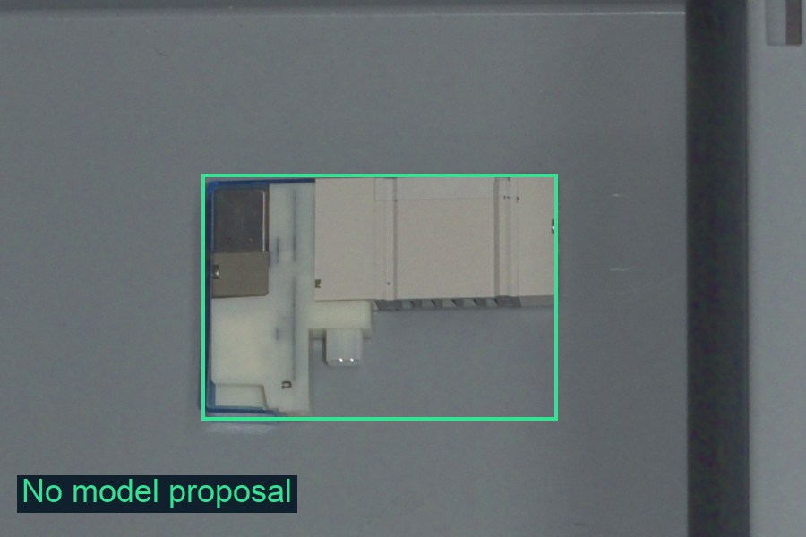
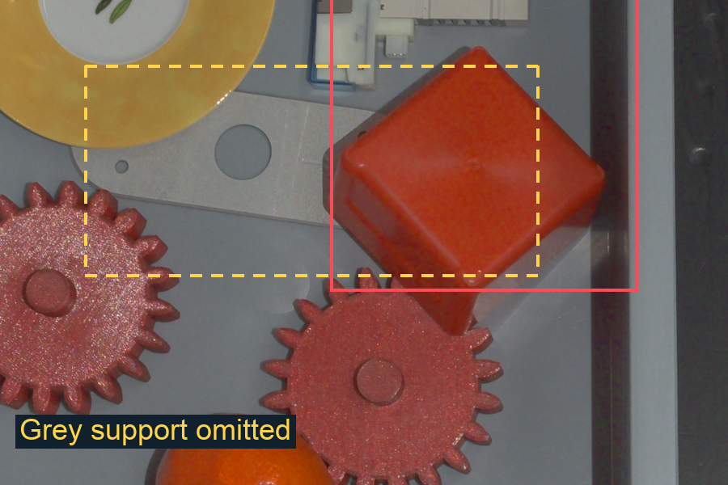

# Apertus failure modes in Path B

Fresh run on all 10 development scenes and 50 instructions, 14 October 2026. Model: apertus-v1.5-70b at the hosted hackathon endpoint; temperature 0, 1024-pixel image limit, 800-token replies, thinking off. Standard Path B uses Apertus for detection, safety and planning, plus OpenCV measurements and its existing coordinate correction. No SAM 3 or scene-graph cache was used.

Grounding: 35/40; non-plan decisions: 9/10; official automatic score: 54.25/65. Run time: 160.1 s.

Scene 08: yellow gear. Raw centre (869, 1285) is on background; corrected centre (869, 1408) is on the gear.

Scene 08: the small white part is visible inside the ground-truth box but has no detection. Instruction 08_i2 is falsely refused.

Scene 09: grey support beneath the cube is omitted. Missing graph evidence causes 09_i3 to ask and 09_i4 to refuse.

**Coordinate bias and naming.** Across 31 spatially matched annotated targets, raw box centres miss 7 masks (24/31 hits); corrected centres hit 31/31. Median raw vertical centre error is -100.5 px relative to mask-box centres. The existing y' = 1.065y + 40 correction masks this weakness. In scene 04, all three parts are called "small white part"; size measurements fix their types. Eight tray-sized proposals are discarded.

**Missing objects propagate into refusals.** The detector omits the small part in scene 08 and the partly occluded grey part in scene 09 (figures above). These omissions explain three of the five false ask/refuse answers. The small part is the only unmatched object among the 32 mask-annotated targets; the grey support is not mask-annotated.

**Instruction semantics fail despite valid JSON.** 08_i1 refuses "the gear in the grey tray" while explicitly acknowledging a yellow gear there. 09_i5 executes pick(mandarin), place(plate), ignoring "and leave it where it is"; ground truth requires refusal. All 50 final answers pass the schema, so valid structure does not guarantee semantic correctness.

**Spatial ambiguity also reflects pipeline limits.** 10_i3 asks which red gear is closest to the mandarin. Both rounded gap measurements are 0 mm in the graph, although ground truth selects red_gear_1. This is an upstream measurement ambiguity; the run does not isolate it as a model-only reasoning failure.

**Limitations.** One run on development data; the existing coordinate correction was fitted to these scenes. Detection audit: greedy one-to-one matching by corrected box IoU &gt;= 0.25, independent of class. Only 32 objects have masks; no full-scene recall estimate. Grounding scores check the first target, not every action or destination. No Path A comparison. All 105 model calls completed without transport errors or token truncation.

**Implication.** Retain mask-aware localization checks, review omitted/occluded objects, and validate contradictions and spatial ties explicitly before robot execution.
