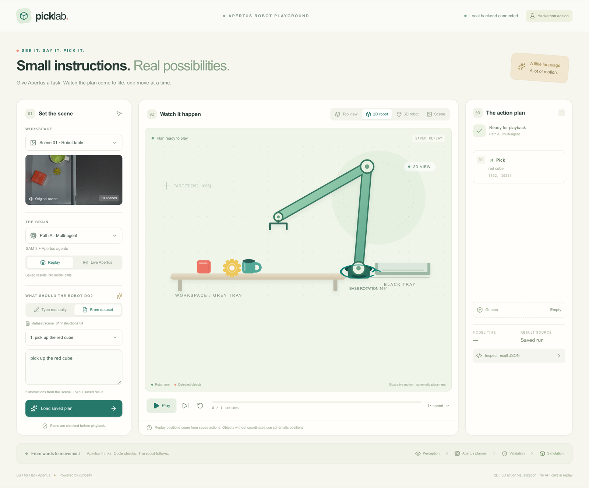

# See It, Say It, Pick It — team Asian Prompters

Our entry for Track 2A, the ZHAW challenge *See It, Say It, Pick It*. One top-down photo of a robot table
and one English instruction go in; a safe robot action comes out: a pick-and-place plan with the target
pixel, a question for the person, or a refusal.

- **Path A** (our submission): Meta's SAM 3 finds the objects, our code builds a scene graph (positions,
  sizes in millimetres, what lies on what), and three Apertus 1.5 70B agents decide: a safety agent, a
  reference agent that chooses the objects, and a constraint agent. Code orders the moves and checks
  every reply.
- **Path B** (our second approach): Apertus finds the objects itself, OpenCV measures them, and one
  Apertus call plans.



*The Pick Lab app (optional, see below) replays a saved plan: the 2D arm, the target pixel and the
action plan.*

## Results on the ten public scenes

Scored with the organisers' `src/starter/evaluate.py`; the held-out scenes have no released answers.

| Pipeline | Grounding (35) | Safety (30) | Automatic total (65) |
|---|---|---|---|
| **Path A, three agents (9 runs)** | 34.1 | 30.0 | **63.0** (62.5–64.1) |
| Path B (4 runs) | 31.5 | 24.3 | 54.0 (52.7–55.8) |
| Organisers' baseline | | | 21.7 |

Both pipelines were tuned on these scenes, so held-out scores will be lower.

## Run it

You need Docker (with at least 16 GB of memory for containers; no GPU) and an Apertus key. From this
folder:

```bash
cp .env.example .env        # then fill in LLM_API_KEY
make run                    # builds the image and runs Path A on data/heldout/
```

The answers go to `results/results_heldout.json`, and every Apertus reply to
`results/logs/results_heldout.log.jsonl`. Our submitted run is already in those two files.

- **Time:** about 13 minutes from a clean checkout on an Apple M1 Max (3.5 min to build the image,
  9 min to run). The first build downloads about 4 GB (the packages, SAM 3 and the depth model), so a
  slow connection adds to that; later runs reuse the image.
- **New photos:** put scene folders in `data/scenes/` (layout: [data/scenes/README.md](data/scenes/README.md))
  and run `make run DATA=data/scenes`; any other folder works too. A folder with `ground_truth/`, like
  `data/dataset/`, also prints the score.
- **Settings:** `LLM_API_KEY`, `LLM_BASE_URL` and `LLM_NAME`, in the environment or in `.env`. Only the
  key is required; the endpoint and model default to the hosted hackathon endpoint and
  `apertus-v1.5-70b`.
- **Without Docker, Path B, tests:** `make help` lists every command; [docs/USAGE.md](docs/USAGE.md)
  explains them.

## See the plans: the Pick Lab app (optional)

The app in the screenshot replays our saved answers for the public scenes with an animated 2D arm, a top
view, a 3D view and the target pixel on the photo, and can run either pipeline live on an instruction you
type. It runs on your machine, not in Docker, and needs [uv](https://docs.astral.sh/uv/) and Node.js
20.9+:

```bash
make app                    # then open http://localhost:3000
```

Replay needs no key and makes no Apertus calls. More: [src/apps/README.md](src/apps/README.md).

## Documents

| | |
|---|---|
| [technical_report.md](technical_report.md) | Architecture, use of Apertus, evaluation, limitations, reproducibility |
| [docs/slides.pdf](docs/slides.pdf) | The five slides |
| [Demo video](https://drive.google.com/file/d/1nHaDBsPiw71muJCHdRV6GNeSMVF0W8_A/view?usp=sharing) | The pipeline running locally |
| [docs/apertus_failure_modes.pdf](docs/apertus_failure_modes.pdf) | The two-page report on where Apertus had difficulty (evidence log: [docs/apertus-difficulties.md](docs/apertus-difficulties.md)) |
| [docs/USAGE.md](docs/USAGE.md) | Every way to run it, with and without Docker |
| [Path A architecture](src/pipelines/path_a/ARCHITECTURE.md), [agents](src/pipelines/path_a/MULTI_AGENT.md), [Path B](src/pipelines/path_b/ARCHITECTURE.md) | How each pipeline works |
| [docs/CHALLENGE.md](docs/CHALLENGE.md), [docs/EVALUATION.md](docs/EVALUATION.md), [docs/DATA.md](docs/DATA.md) | The organisers' challenge, scoring and data notes |

Code: Apache 2.0. Data in `data/dataset/`: CC BY 4.0. SAM 3 is Meta's model, used under the SAM
License.

---

# Track 2A: Academia Challenges (from the Hack Apertus template)

Submissions must use the Apertus model family.
For Track 2 this means that submitted solutions must be built with Apertus. Other open-weights models can be used to support development, e.g. as automatic judges during evaluation. Their role must be clearly described in the submission report.

💬 In case you have questions, join the conversation on Discord or send an email to “hello@hackapertus.ch”

## How it works
Pick from 5 academia challenges provided by Swiss academic institutions:

- **FHGR:** AI-Powered Job Interview Coach
- **OpenParlData:** Extracting Parliamentary Affairs from PDFs into One Common Structure
- **OST:** Multilingual Natural Language Inference over Swiss Official Voting Booklets
- **UZH:** Detecting Cross-Lingual Semantic Differences in Swiss Government Websites
- **ZHAW:** See It, Say It, Pick It: Vision-Language Grounding for a Real Robot Arm

The challenges incl. submission and judging criteria are described in our **Getting Started guide**:
https://hackapertus.notion.site/getting-started-guide-onlinehack

## Run it

From the root of the project:

```bash
make run
```

Requirements:

- **Runtime:** Docker. `make run` builds the image and runs Path A on `data/heldout/`; the answers go
  to `results/results_heldout.json`. `make run DATA=path/to/scenes` runs any folder of scenes.
- **Hardware:** any machine that runs Docker, with at least 8 GB of memory for the container. No GPU
  is needed: the image uses PyTorch's CPU-only build.
- **API keys:** `LLM_API_KEY` for the Apertus endpoint, in the environment or in `.env` (see
  `.env.example`). `LLM_BASE_URL` and `LLM_NAME` default to the hosted endpoint and
  `apertus-v1.5-70b`.
- **Model weights:** Meta SAM 3 (from the ungated, byte-identical copy `jetjodh/sam3`) and Depth
  Anything V2 Small, both downloaded into the image during the build; no Hugging Face token is needed.

## Data
The `data/` directory must not exceed 100 MB.


## 📦 Submission Requirements & Deliverables
❗️ Submissions are not handled on Devpost. Submit through our website only:
http://hackapertus.ch/online-hack/submissions

Requirements differ by challenge. See the description of the challenge you are entering for the exact deliverables.


## ⚖️ Judging Criteria
Judging criteria also differ by challenge. See the respective challenge description.


## Support

**Licensing requirements**
Please check our Terms & Conditions (6. What you build is open source):
https://hackapertus.ch/terms-and-conditions

## FAQ
💡 https://hackapertus.ch/faq

## Contact
💬 In case you have questions, join the conversation on Discord or send an email to “hello@hackapertus.ch”
